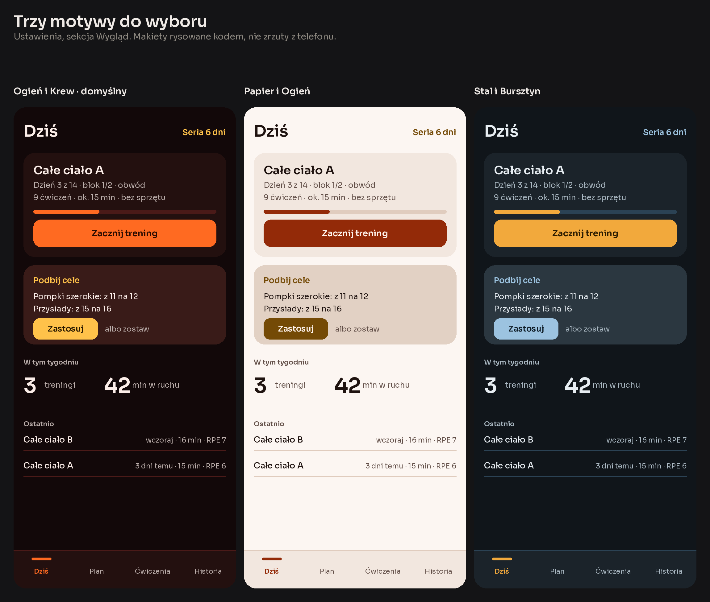
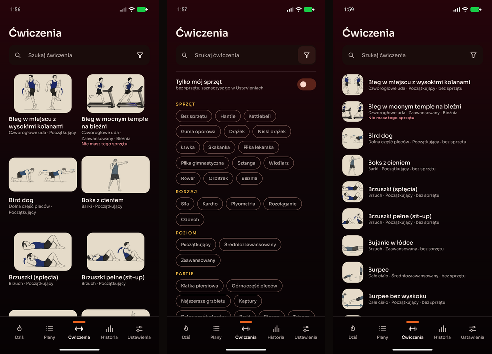
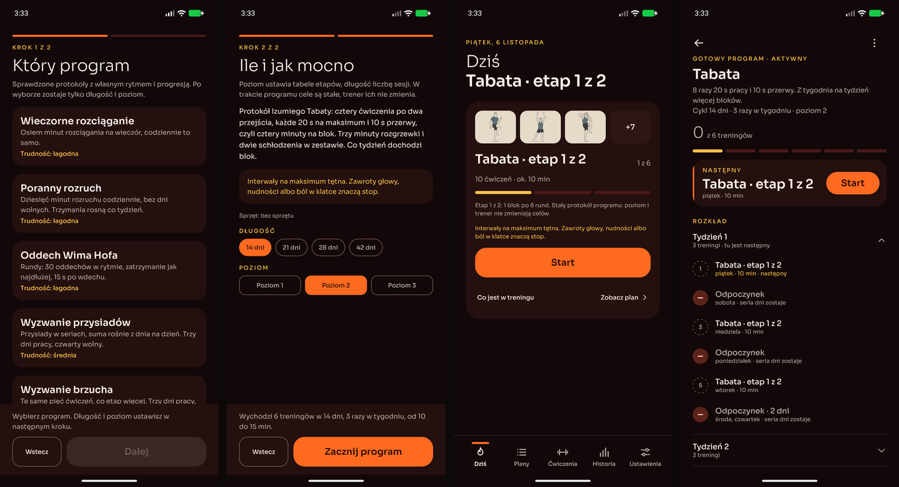
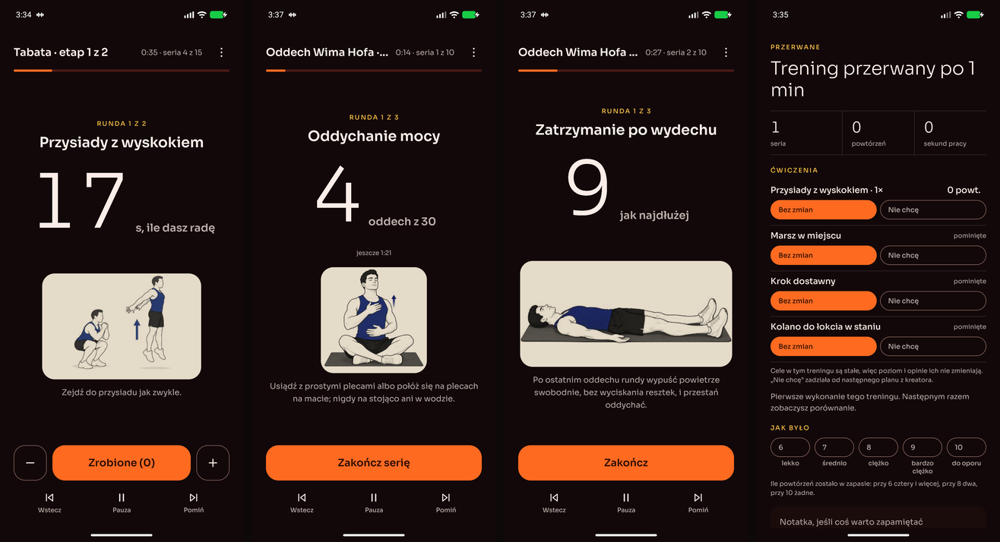

# Changelog

Co warto wiedzieć o kolejnych wydaniach mysttic-trainings. Format trzyma się
[Keep a Changelog](https://keepachangelog.com/pl/1.1.0/), numeracja
[wersjonowania semantycznego](https://semver.org/lang/pl/).

Numer wydania mieszka w [VERSION.md](VERSION.md) i to on uruchamia wydanie:
workflow rusza tylko wtedy, gdy ten plik był wśród zmian scalonych do `master`.
Opis z sekcji danej wersji trafia wprost do wydania na GitHubie.

Sekcje „Baza N” to wydania bazy ćwiczeń, która od 1.1.0 ma własny numer (D-47).
On też stoi w VERSION.md, ale bazę wydaje osobny workflow po zmianie w `baza/`,
a numeracja to kolejne liczby, bez wersjonowania semantycznego.

Repozytorium jest publiczne od 2026-11-05 i zaczyna od stanu 1.1.0 (D-48). Wersje do 1.0.0
zostają tu opisane, ale bez odnośników: ich tagi i historia nie przeszły do tego repozytorium.

## [Niewydane]

## [Baza 11]

Zdjęcia tła do „Zdjęcia dnia” (D-51), razem z aplikacją 1.2.0, która jako pierwsza je pokazuje.

### Dodane
- **35 zdjęć tła**: brzuch, nogi, góra ciała, całe ciało, kardio i joga, każdy temat z kobietą i z mężczyzną.
  Zdjęcia są rozmyte i w skali szarości, a kolor nadaje im motyw aplikacji. Ćwiczenia bez zmian.

### Zmienione
- **Baza wymaga aplikacji 1.2.0.** Wersja 1.1.0 nie zna zdjęć tła, więc zamiast pobierać bazę pokaże
  „najpierw zaktualizuj aplikację”.

## [1.2.0]

### Dodane
- **Zakładka Plany.** Lista planów jest w dolnym pasku, obok „Dziś”: aktywny plan, czekające i zakończone, a w nagłówku
  „Nowy plan” z czterema drogami — kreator, gotowy program, własny plan i plan z pliku od kogoś (issue #1, D-53).
- **Zdjęcie dnia w tle, a na nim gradient do wyboru.** Pod wszystkimi ekranami leży rozmyte zdjęcie w klimacie
  dzisiejszych treningów ze wszystkich planów, z osobami twojej płci z „O mnie” (bez wyboru obie). Losuje się raz
  dziennie spośród trzech tematów, których dziś najwięcej, więc tylko nawiązuje do dnia, a nie ogłasza, co ćwiczysz.
  W Ustawienia → Wygląd → Tło wybierasz, co leży na zdjęciu: samo zdjęcie (domyślnie) albo jeden z trzech gradientów
  motywu, który zdjęcie zabarwia, ale go nie zasłania. „Ogień i Krew”: Żar, Łuna i Wino, „Papier i Ogień”: Świt, Róża
  i Pergamin, „Stal i Bursztyn”: Granat, Głębia i Zmrok, „Brzoza i Mech”: Mgła, Paproć i Wrzos. Karty są szklane,
  żeby zdjęcie prześwitywało, a napisy i obrysy przycisków trzymają ten sam kontrast co zawsze. Tło stoi w miejscu przy
  przewijaniu, a każdy motyw pamięta swoje. Zdjęcia przychodzą z bazą ćwiczeń 11 (D-50, D-51, D-55).
- **Motyw „Brzoza i Mech”.** Czwarty motyw, jasny jak kora brzozy, z zielenią mchu na akcji i żywicą w podpowiedziach
  (D-56).
- **O mnie.** Pierwsza kategoria Ustawień: imię, którym podpisujesz plany i raporty, płeć (od niej zależą osoby
  na zdjęciu dnia), wzrost i waga, od których startuje kreator, oraz klucz podpisu planów. Wybór osób na zdjęciu zniknął
  z „Wyglądu” (D-57).
- **Plan podpisany, z hasłem na życzenie.** Wysłany plan jest podpisany twoim imieniem i kluczem tego telefonu: kto
  zmieni w pliku autora albo treść, ten zepsuje podpis i plik się nie wczyta. Odbiorca widzi w podglądzie odcisk
  klucza i porówna go z tym, który autor ma w „O mnie”. **Chroń hasłem** zamyka plik hasłem: bez niego pliku nie otworzy
  nikt, także aplikacja. Plany z wcześniejszych wersji wchodzą jak dotąd, oznaczone „Bez podpisu”; plik z 1.2.0
  wersja 1.1.0 odeśle do aktualizacji (D-58).
- **Zdjęcia tła w edytorze bazy (dla właściciela).** `python tools/baza.py` ma sekcję „Zdjęcia tła”: dodawanie
  zdjęcia z tematem i płcią, podmiana w to samo miejsce, usuwanie i podgląd w kolorach każdego motywu, takich jak
  w aplikacji. Edytor sam kadruje zdjęcie pod telefon, odbarwia je i rozmywa.
- **Kopia treningu w edytorze planu.** „×2” przy treningu planu dokłada jego kopię, więc drugi trening układasz
  z pierwszego, podmieniając ćwiczenia, zamiast od zera. Kopia ma w nazwie „(kopia)”, a przy kolejnych
  „(kopia 2)”, „(kopia 3)”. Tak samo nazywa się trening skopiowany z innego planu, gdy plan ma już trening
  o tej nazwie, żeby przy wyborze treningu dnia nie pomylić ich ze sobą.
- **Tablet: lista i szczegół obok siebie.** Na tablecie w poziomie Ćwiczenia pokazują listę i wybrane ćwiczenie naraz,
  Ustawienia — kategorie i otwartą kategorię, a „Dziś” ma dwie kolumny (D-52).

### Zmienione
- **Nowy wygląd (issue #5, D-52).** Projekt powstał w designerze, motywy, tła i kolory zostają, zmienia się układ:
  - nawigacja z ikonami, pięć zakładek;
  - „Dziś” na start pokazuje dwa wybory zamiast pustych statystyk, a karta treningu ma miniatury ćwiczeń; statystyki
    stoją pod kartą, gdy jest już jakaś historia;
  - w bibliotece nad listą jest tylko szukanie z przyciskiem filtrów; „Tylko mój sprzęt” i widok kafelki / lista są
    w panelu filtrów, a wyniki, warianty, zamienniki i trener w szczegółach ćwiczenia zwijają się do jednej linii;
  - Ustawienia to siedem kategorii z podsumowaniem zamiast jednej długiej strony; motyw i tło są razem w „Wygląd”,
    a imię, płeć, wzrost i waga w „O mnie”;
  - player jest prostszy: nazwa ćwiczenia dużym tytułem, poziom trudności i „Przerwij trening” w menu ⋮, a Wstecz,
    Pauza i Pomiń jako ciche przyciski z ikoną.
- **Nowy wygląd także w Historii, podglądzie planu, kreatorze i edytorach (issue #5, D-54).** Cała aplikacja mówi
  teraz jednym językiem:
  - Historia przed pierwszym treningiem nie straszy zerami; potem wykresy czekają w zwiniętym „Postępie”, nad listą
    wybierasz wszystkie, ukończone albo przerwane, a sesje idą miesiącami. W szczegółach sesji są trzy liczby,
    porównanie z poprzednim razem, zwinięta lista serii i **Zapisz ocenę**; usunięcie przeszło do menu ⋮;
  - podgląd planu pokazuje kartę następnego treningu i rozkład tygodniami: rozwinięty jest tydzień z następnym
    treningiem, a kolejne dni odpoczynku stoją jednym wierszem;
  - kreator da się zamknąć z każdego kroku, sprzęt zaznaczasz pigułkami, a ostatni krok streszcza odpowiedzi
    i jednym tapnięciem wraca do wybranego kroku;
  - w edytorze planu dni są pogrupowane tygodniami, przy dniu zostały strzałki, a duplikat i usunięcie dnia są
    w menu ⋮; w edytorze treningu ustawienia bloku zwijają się do jednej linii, akcje bloku są w jego menu ⋮,
    a zamiana, duplikat i usunięcie ćwiczenia w arkuszu po tapnięciu w ćwiczenie;
  - na tablecie w poziomie Historia stoi jako lista i szczegół sesji obok siebie, a podgląd planu, kreator
    i edytor planu mają dwie kolumny.
- **Kreator zaczyna od sprzętu.** Pierwszy krok to sprzęt, który masz, z licznikiem, z ilu ćwiczeń kreator ułoży
  plan; drugi to wzrost, waga i poziom, wpisane z „O mnie” i tam zapisywane z powrotem; potem cel i czas (D-57).
- **„Dziś” nie mówi, jaką partię ćwiczysz.** Nagłówek „Dziś trenujesz całe ciało” ustąpił „Trening na dziś”, bo zdjęcie
  dnia ma tylko nawiązywać do treningu (D-55).
- **Kopia planu od kogoś zachowuje autora.** Skopiowany plan od kogoś dalej podaje jego autora, także w wysłanym
  pliku, a ty jesteś w nim jako przekazujący (D-58).
- **Nowy plan własny zaczyna od celów dokładnie takich, jak wpisane.** Przełącznik „Dopasowuj cele do poziomu
  i trenera” jest w nowym planie wyłączony, więc plan dla kogoś nie wymaga już pamiętania o nim przed „Wyślij plan”.
  W planie dla siebie, który ma rosnąć z poziomem, trenerem i „Podbij cele”, włączasz go jednym ruchem.
  Zapisane plany zostają przy swoim ustawieniu.
- **Kopia treningu do planu z celami dokładnie jak wpisane ma te liczby, które widziałeś.** Trening skopiowany z planu
  dopasowanego do poziomu (na przykład z kreatora) wchodzi z wariantem ćwiczenia, celami i przerwami twojego poziomu
  i sprzętu, a nie z bazowymi liczbami średniego poziomu.
- **Wyjście z edycji planu pyta o zmiany także po dodaniu treningu.** Gdy w edycji zapisanego planu doszedł trening
  (nowy, skopiowany albo „×2”), Wstecz pyta „Porzucić zmiany?”: „Porzuć” go zabiera, a „Zapisz plan” zostawia.
  Wcześniej przy niezmienionych dniach Wstecz wychodził bez pytania, a niepotrzebnego treningu nie dało się
  potem usunąć.
- **Kopia zapasowa w wersji 5 niesie tło każdego motywu oraz płeć, wzrost i wagę z „O mnie”.** Starsze kopie wczytują się
  jak dotąd i nie zmieniają wybranego tła; kopii z 1.2.0 nie wczyta wersja 1.1.0, więc na nowym telefonie najpierw zaktualizuj aplikację.
- **Niewybrane pigułki filtrów i „−”/„+” w playerze są bez wypełnienia**, z samą obwódką, jak pozostałe przyciski
  drugorzędne; na kartach i w oknach biorą kolor karty.
- **Kod jest publiczny.** Repozytorium zaczyna od stanu 1.1.0, bez wcześniejszej historii (D-48). Kod jest
  na licencji MIT, a baza ćwiczeń (nazwy, opisy, instrukcje i ilustracje) na CC BY 4.0. W samej aplikacji
  nic się nie zmienia.

### Poprawione
- **Ilustracje ćwiczeń przy ciemnym motywie i jasnym systemie.** Filtr ilustracji brał tryb systemu zamiast motywu,
  więc „Ogień i Krew” przy jasnym systemie pokazywał ilustracje białe jak kartka. Ilustracje mają też swoje proporcje,
  bez pasów tła u góry i po bokach.
- **Podwójna kropka w „Podbij cele”** („9 powt..”).

## [1.1.0]

### Dodane
- **Nowa baza ćwiczeń bez nowej wersji aplikacji.** Ustawienia → Aktualizacje szukają przy tym samym pytaniu także
  nowszej bazy ćwiczeń i pokazują, ile ćwiczeń przybyło, zmieniło się i zostało wycofanych. „Pobierz bazę” ściąga ją,
  sprawdza i wczytuje od razu; historia, plany i notatki zostają. Bazę, która zgubiłaby ćwiczenie z historii albo
  gotowego programu, aplikacja odrzuca i mówi dlaczego, a bazę dla nowszej aplikacji zostawia do czasu aktualizacji.
- **Edytor bazy ćwiczeń (dla właściciela).** `python tools/baza.py` otwiera bazę w przeglądarce: nowe ćwiczenie
  z ilustracją (wystarczy przeciągnąć plik), poprawki opisu, celu, sprzętu i wariantów, wycofanie ćwiczenia z datą,
  szkice czekające na ilustrację i paczki z generatora zdjęć. Każdy zapis przechodzi reguły bazy, więc ćwiczenie,
  które zepsułoby historię albo plany, nie wejdzie.
- **Wycofane ćwiczenia.** Ćwiczenie wycofane z bazy znika z biblioteki, kreatora planu, zamienników i wyszukiwarki
  edytora treningu, ale zostaje w historii, zapisanych planach i notatkach. Jego szczegóły mówią, od kiedy jest
  wycofane. Aktualizacja przenosi bazę danych migracją, bez utraty historii.

### Zmienione
- **Baza ćwiczeń z własnym numerem i własnymi wydaniami.** Ćwiczenia i ilustracje mają osobną bazę (v10), którą
  wydaje się niezależnie od aplikacji: po scaleniu zmiany trafia na stronę projektu jako osobne wydanie z ZIP-em
  i manifestem (D-47). W samej aplikacji nic się nie zmienia: te same 283 ćwiczenia i ilustracje. Numer bazy stoi
  w VERSION.md obok numeru aplikacji, a każde wydanie bazy ma tu własną sekcję z opisem, poczynając od Bazy 10.
- **Pewniejsze sprawdzanie aktualizacji.** Aplikacja bierze ze strony projektu najwyższą wersję aplikacji i bazy,
  a nie pierwszą z listy, a wydanie, którego pliki jeszcze się wgrywają, traktuje jak brak nowości zamiast błędu.
  Strona projektu pokazuje teraz pod numerem aplikacji także numer i datę bazy ćwiczeń.

## [Baza 10]

Pierwsze wydanie bazy ćwiczeń osobno od aplikacji (D-47), razem z aplikacją 1.1.0, która jako pierwsza sama
pobiera nowsze bazy.

### Zmienione
- **Ta sama treść w nowym układzie.** 283 ćwiczenia z ilustracjami, takie same jak w bazie wbudowanej w 1.0.0:
  bez nowych, zmienionych i wycofanych. Nowe są własny numer bazy, format i najniższa wersja aplikacji, która ją
  przyjmie (1.1.0).

## [1.0.0] - 2026-10-01

**Pierwsze wydanie stabilne.** Aplikacja wychodzi z fazy testowej: plany do udostępniania, własny edytor planu,
statystyki z raportem PDF, obsługa tabletów, ergometry i 89 nowych ćwiczeń domykają to, co miała robić. Od tej wersji
każda zmiana bazy danych przechodzi migracją, więc aktualizacja nigdy nie wymaga odinstalowania ani nie gubi historii.

To wydanie zawiera też zmiany z wersji 0.10.0, która nie trafiła do pobrania: trzy motywy do wyboru w Ustawieniach
→ Wygląd, czyli „Ogień i Krew” (domyślny), jasny „Papier i Ogień” i chłodny „Stal i Bursztyn”.

### Dodane
- **Twoje plany.** Aplikacja trzyma listę planów: z kreatora, gotowe programy, własne i od innych osób. Aktywny jest
  jeden, a przełączyć można w każdej chwili — bieżący plan czeka wtedy ze swoim postępem. Plan da się zduplikować,
  zacząć od nowa (nowy przebieg z osobnymi statystykami), przemianować i usunąć. Wejście: „Twoje plany” na ekranie
  „Dziś” i w podglądzie planu.
- **Własny plan od zera.** Edytor planu: treningi planu, rozkład dni z odpoczynkami, „Rozpisz tygodnie” (np. 4 tygodnie
  po 3 treningi) i „Kolejny tydzień jak ostatni”. Przełącznik decyduje, czy cele dopasowują się do poziomu i trenera,
  czy zostają dokładnie takie, jak wpisane. Zrobione dni aktywnego planu są zablokowane.
- **Więcej w treningu:** ciężar przy ćwiczeniu, wskazówka do pozycji (pokazuje ją player w trakcie serii), nazwa bloku,
  przerwa po bloku, zmiana ćwiczenia z zachowaniem serii i przerw, duplikowanie pozycji i bloku.
- **Wysyłanie planów.** „Wyślij plan” tworzy plik, który można przesłać komunikatorem, mailem albo zapisać w Plikach.
  Odbiorca otwiera go w aplikacji, widzi podgląd (treningi, autor, brakujący sprzęt) i dodaje plan do swojej listy —
  dokładnie takim, jak go ułożono. Plan, który u Ciebie dopasowuje się do poziomu, jedzie z ćwiczeniami i liczbami,
  które widzisz na swoim poziomie i ze swoim sprzętem. W pliku nie ma wzrostu, wagi ani historii treningów.
- **Statystyki planu i raport PDF.** Dla każdego planu osobno: frekwencja, tygodnie planu, wykonane serie, średni
  wysiłek i postęp w ćwiczeniach. Raport PDF można udostępnić (np. osobie, która ułożyła plan) albo zapisać;
  notatki z treningów trafiają do niego tylko po zaznaczeniu przełącznika.
- **Tablety i ekran w poziomie:** nawigacja z boku, treść w czytelnej szerokości, więcej kolumn w bibliotece,
  player z liczbą po lewej i przyciskami po prawej.
- Imię na planach i raportach ustawisz w Ustawieniach → Plany.
- **Ergometry.** Wioślarz, rower stacjonarny, orbitrek i bieżnia są do zaznaczenia w Ustawieniach → Sprzęt i w filtrach
  biblioteki, a do każdego są ćwiczenia na czas: jazda spokojna, tempo, sprinty i ćwiczenia techniczne. Trening na
  ergometrach ułożysz w edytorze treningu albo planu; kreator planu ich nie używa, więc plany z kreatora zostają
  bez maszyn.
- **Cele na czas do godziny.** W edytorze treningu czas ćwiczenia sięga 60 minut, a przyciski zmieniają go co 5 sekund
  przy krótkich celach, co 15 sekund do 10 minut i dalej co minutę. Czas od minuty widać jako „12:00”, jak w playerze.
- **89 nowych ćwiczeń z ilustracjami:** 20 na ergometrach, 40 ze sprzętem (hantle, kettlebell, guma, ławka, drążek,
  piłka lekarska i gimnastyczna, skakanka) i 29 uzupełniających: komplet ćwiczeń ze sztangą, która dotąd nie miała
  żadnego, zamienniki dla wąskich partii (odwodziciele, kaptury, biceps, przedramiona), plyometria oraz trudniejsze
  i łatwiejsze warianty bez sprzętu. Każde z opisem krok po kroku. Kreator ma więcej do wyboru: zaawansowany bez
  sprzętu dostaje ciągnięcie i kardio na swoim poziomie, a „Nie chcę” przy wąskich partiach ma czym podmienić.
- **Notatki do ćwiczeń w planie.** W szczegółach treningu przy każdym ćwiczeniu dopiszesz notatkę, na przykład
  „60 kg, drugi otwór” przy wyciskaniu. Wraca przy tym ćwiczeniu w każdym treningu i tygodniu tego planu, w playerze
  w trakcie serii i na karcie „Dalej” w przerwie, a w innym planie jej nie ma. Działa też w gotowych programach
  i planach od kogoś. Kopia planu zabiera notatki, plik planu wysłany komuś też je niesie, a kopia zapasowa je przenosi.
- **Trudność gotowych programów.** Lista programów idzie od łagodnych do wymagających, a każda karta mówi, jak ciężki
  jest sam program: łagodna (rozciąganie, poranny rozruch, oddech), średnia (przysiady, brzuch, 100 pompek, deska
  i drążek) albo wysoka (Siedem minut, Tabata, Burpee co minutę, Iron Man). Poziom 1, 2 albo 3 wybierany przy starcie
  dalej ustawia liczby w etapach.
- **Pominięte ćwiczenia w podsumowaniu.** Ćwiczenie pominięte w całości stoi na liście z dopiskiem „pominięte”
  i z tymi samymi opiniami co reszta, więc właśnie tam można powiedzieć „Nie chcę”. Po przerwaniu treningu na liście
  są tylko ćwiczenia, przez które trening przeszedł, a nie te, do których nie doszedł.

### Zmienione
- Gotowego programu nie blokuje już trwający plan: zamiast odmowy jest uprzedzenie, że bieżący plan zaczeka.
- Poziom trudności w Historii to poziom z końca treningu (po zmianie w trakcie), a nie ze startu. Tak samo przy
  treningu przerwanym, a sesja z gotowego programu pokazuje poziom, na którym program został założony.
- Ciężar w playerze po polsku („22,5 kg” zamiast „22.5 kg”).
- Kopia zapasowa w wersji 4 niesie listę planów z autorami, przypisanie treningów do planów i notatki do ćwiczeń;
  starsze kopie wczytują się dalej, a plik planu wczytany w miejscu kopii daje czytelny komunikat.
- Seed v7: trzy wbudowane treningi (Full body A i B, Core + tabata) wypadają z aplikacji. Od czasu, gdy „Dziś”
  pokazuje wyłącznie pozycję z kolejki, nie było do nich żadnego wejścia, a ich treść pokrywa program Tabata
  i kreator planu. Trening, który masz w historii, zostaje.
- Ćwiczenia oddechowe nie pojawiają się już w wyszukiwarce edytora treningu: bez rytmu z gotowego programu byłyby
  zwykłym timerem.
- **Ocena wysiłku ma podpisy.** Pigułki od 6 do 10 w podsumowaniu mówią, co znaczą (od „lekko” do „do oporu”),
  a podpowiedź tłumaczy skalę zapasem powtórzeń zamiast mylącego „6 to spacer”. Szczegóły sesji w Historii mają
  ten sam wybór zamiast suwaka od 1 do 10, a ponowne tapnięcie czyści ocenę. Oceny wystawione wcześniej zostają.

### Naprawione
- **Stary trening nie wraca jako trwający.** Start po długiej przerwie wznawiał zapisany stan treningu sprzed wielu
  godzin, więc sesja w Historii potrafiła trwać ponad 20 godzin. Stan starszy niż 6 godzin jest teraz zamykany jako
  przerwany z godziną ostatniego zapisu, a trening zaczyna się od nowa. Seria na powtórzenia wznowiona po dłuższej
  przerwie czeka w pauzie, zamiast doliczać martwy czas.
- Okno „Przerwać trening?” podaje tyle serii, ile naprawdę zapisze, także po pominiętych.
- Podsumowanie i Historia odmieniają liczby po polsku („1 seria”, „18 serii”, „16 sekund pracy”), a data sesji
  w Historii jest po polsku.
- **Kopia zapasowa nie cofa już zmian w planach, które masz.** Wczytanie kopii na telefonie, na którym te plany
  już są, pomijało same plany, ale ich treningi nadpisywało stanem z pliku: podbite cele i zmiany z edytorów
  wracały po cichu do starych liczb. Teraz plan, który już masz, zostaje nietknięty razem z treningami.
- **„Podbij cele” liczy od tego, co widzisz.** Karta proponowała podbicie z wartości szablonu, więc po „Mniej”
  u trenera mówiła „11 → 12” tam, gdzie na ekranie stało 9, a potem znikała na dobre. Teraz liczy się od celu
  pokazanego (poziom plus korekta trenera), jeden tap przesuwa go dokładnie o jeden krok, a propozycje pojawiają
  się także na poziomie początkującym i zaawansowanym, gdzie wcześniej milczały. Trening zrobiony przy innej
  korekcie niż obecna dalej propozycji nie daje, bo nie ma czego porównać.
- **Trudniejsza wersja ćwiczenia nie wskoczy bez sprzętu.** Po przełączeniu poziomu albo odznaczeniu sprzętu
  player potrafił wystawić wariant wymagający ławki czy drążka, na przykład pompki z nogami na podwyższeniu
  zamiast zwykłych pompek. Teraz bez sprzętu zostaje ćwiczenie z planu; z zaznaczonym sprzętem wariant wchodzi
  jak dotąd.
- **Burpee co minutę trzyma minutę.** Przerwa w EMOM była liczona z założenia trzech sekund na powtórzenie, więc
  przy wolniejszym tempie runda rozciągała się do półtorej minuty. Teraz przerwa to tyle, ile zostało do końca
  minuty: szybsza seria znaczy dłuższy odpoczynek, a seria dłuższa niż okno przechodzi od razu w kolejną rundę.
  Dotyczy programu założonego po aktualizacji; cykl Burpee co minutę, który już trwa, liczy przerwę po staremu.
- **Powiadomienie wraca po nadaniu zgody.** Zgoda na powiadomienia włączona w Ustawieniach w trakcie trwającego
  treningu odblokowuje je od razu, bez czekania na kolejne ćwiczenie.
- Treningi po planach usuniętych przed wersją 0.9.1 znikają same przy pierwszym uruchomieniu po aktualizacji.
  Te, które masz w historii, zostają.
- **Gotowy program nie podsuwa sprzętu, którego nie masz.** „Siedem minut” bez zaznaczonej ławki dostaje zamienniki
  bez sprzętu: wykrok skrzyżny zamiast wejść na podwyższenie i pompki wąskie (na poziomie 1 wyprost ramion w klęku)
  zamiast dipów; notatka etapu mówi, co podmieniono. „Deska i drążek” bez zaznaczonego drążka jest na liście
  wyszarzona z podpowiedzią, gdzie go zaznaczyć. Szczegóły treningu z programu nie obiecują już zamiennika, którego
  player i tak by nie użył. Dotyczy programu założonego po aktualizacji.
- **Deska boczna w „Siedmiu minutach” na dwie strony.** Druga strona szła bez przerwy i wyglądała tak samo jak
  pierwsza, więc łatwo było wziąć ją za przerwę, a trening kończył się w jej trakcie. Teraz między stronami jest
  5 sekund na zmianę, a player podpisuje „Pierwsza strona” i „Druga strona”. Dotyczy programu założonego
  po aktualizacji.

## [0.10.0] - 2026-09-19

### Dodane
- **Trzy motywy do wyboru** (Ustawienia → Wygląd): „Ogień i Krew” (domyślny, bez zmian), „Papier i Ogień” — ten sam
  ogień na jasnym papierze, i „Stal i Bursztyn” — chłodny grafit z bursztynem tylko na akcji. Każdy motyw to jeden
  skończony wygląd: aplikacja nie przełącza się już sama na jasny czy ciemny razem z systemem, tylko trzyma ten,
  który wybierzesz. Wszystkie trzy mają komplet 35 ról i trzymają te same progi kontrastu co dotychczasowy.
  Wybór wchodzi do kopii zapasowej.

  

## [0.9.1] - 2026-09-19

### Naprawione
- **Kopia zapasowa przenosi teraz plan.** Eksport wiózł treningi wygenerowane dla cyklu, ale nie sam cykl, więc
  po wczytaniu pliku na nowym telefonie ekran „Dziś” był pusty, a treningi zostawały w bazie bez wejścia.
  Plik dostał sekcję z cyklami (wersja 2); cykl, który już masz, jest pomijany, a aktywny cykl z pliku wraca
  jako aktywny. Starsze kopie wczytują się bez zmian.
- **Kopia zapasowa przenosi wszystkie ustawienia.** Z pliku wracało siedem ustawień z czasów MVP; przypomnienie,
  klawisz głośności jako „Zrobione”, zapis do Health Connect, sprawdzanie wydań i widok biblioteki ginęły przy
  imporcie. Teraz wracają w komplecie, a włączone przypomnienie od razu dostaje alarm.
- **„Usuń plan” sprząta po sobie.** Treningi skasowanego cyklu zostawały w bazie na zawsze i jechały w kopii
  zapasowej. Znikają razem z planem — poza tymi, które masz w historii.
- **Codzienne przypomnienie w ogóle nie działało.** Odbiornik alarmu nie dostawał swoich zależności, więc powiadomienie
  „Czas na trening” nie pojawiało się ani razu, cicho, bez żadnego błędu na ekranie. Teraz przychodzi o ustawionej godzinie.
- **Kasowanie treningu z planu blokowało cykl.** „Usuń trening” w szczegółach dawało się kliknąć także dla treningu
  z kolejki cyklu — dzień planu wskazywał potem na nic, „Dziś” pokazywało pusty kafelek, a Start kończył się błędem;
  jedynym wyjściem było skasowanie całego planu. Takiego treningu nie da się już usunąć osobno, a ekran mówi dlaczego.
- **Kopia systemowa Androida cofała historię.** Baza pracowała w trybie, w którym ostatnie zapisy leżą w osobnym pliku
  pomijanym przez kopię, więc po odtworzeniu na nowym telefonie brakowało kilkunastu ostatnich sesji.
- **Historia wpisywała ocenę, której nie dałeś.** Zapisanie samej notatki do starej sesji stemplowało RPE 5 na stałe.
  Ocena zapisuje się dopiero, gdy ruszysz suwak.
- **Podsumowanie treningu nie gubi już opinii.** Obrót ekranu czyścił ocenę, notatkę i opinie o ćwiczeniach,
  a wstecz zamykał podsumowanie bez zapisu — opinii dla trenera nie da się wpisać nigdzie indziej. Teraz przeżywają
  obrót, a wyjście przez wstecz pyta o potwierdzenie. Tak samo kreator planu i wybór gotowego programu nie wracają
  już do kroku 1 po obróceniu telefonu.
- **Edytor treningu pyta, zanim porzuci zmiany.** Strzałka i gest wstecz kasowały nazwę, notatkę i bloki bez ostrzeżenia.
- **„Podbij cele” nie proponuje ćwiczeń na sprzęt, którego nie masz.** Po dobiciu limitu propozycja trudniejszego wariantu
  sprawdza teraz Twój sprzęt — wcześniej mogła wpisać do planu np. wariant z ławką, choć ławki nie ma.
- **Historia przewija się w całości.** Nagłówek z filtrami i wykresami stał nad listą i zabierał większość ekranu;
  teraz przewija się razem z sesjami. Przy pustej historii nie ma już pustego wykresu i pustego kalendarza.
- Okno „Usunąć sesję?” ma przyciski w tej samej kolejności co pozostałe pytania w aplikacji: po prawej „Zostaw”.

## [0.9.0] - 2026-09-16

### Zmienione
- **Biblioteka ćwiczeń**: filtry w rozwijanym panelu zamiast dwóch rzędów chipów. Cztery sekcje (sprzęt, rodzaj, poziom,
  partie) z wieloma zaznaczeniami naraz: wartości w sekcji łączą się „lub”, sekcje „i”, więc „Kardio” z „Bez sprzętu”
  i „Hantle” daje kardio na samych hantlach. „Mój sprzęt” i licznik wyników zostają na pasku obok przycisku „Filtry · n”,
  a zwinięty panel oddaje ekran ilustracjom. Chipy pokazują tylko wartości, które w bibliotece występują.
- **Kafelki w bibliotece**: domyślny widok to dwie kolumny kafelków z ilustracją w całości na pół szerokości ekranu,
  nazwą, partią i poziomem; przełącznik Lista / Kafelki w nagłówku, wybór zapamiętany.

  

## [0.8.0] - 2026-09-16

### Dodane
- **Gotowe programy** (D-37): obok kreatora drugi sposób na cykl. Jedenaście stałych protokołów z wyborem długości
  i poziomu: Tabata, Iron Man, Wyzwanie brzucha, 100 pompek, Siedem minut, Deska i drążek, Poranny rozruch, Wieczorne
  rozciąganie, Wyzwanie przysiadów, Burpee co minutę i Oddech Wima Hofa. Etapy idą w kolejce (te same ćwiczenia, co jakiś
  czas więcej), a karta „Dziś” mówi, co w tym etapie rośnie. Naraz jeden program; kolejny po zamknięciu cyklu.

  

- **Player prowadzi oddech**: krok w rytmie z licznikiem oddechów i zatrzymanie bez limitu z czasem liczonym w górę
  („Zakończ” albo klawisz głośności). Obwody mówią i pokazują numer rundy.

  

- Seed v6: sześć nowych ćwiczeń z ilustracjami (cztery oddechowe, kobra, skręt w leżeniu), 194 łącznie.

### Zmienione
- „Ile dasz radę” liczy od zera i zapisuje licznik także wtedy, gdy czas minie bez tapnięcia.
- „Wygeneruj kolejny cykl” w planie pojawia się dopiero po domknięciu kolejki.

## [0.7.0] - 2026-09-13

### Zmienione
- **Cała biblioteka w jednym stylu.** Ostatnie 77 ćwiczeń, które miały zdjęcia z sieci, dostało własne
  ilustracje: pompki, przysiady, wykroki, plank, brzuszki, podciąganie, ćwiczenia z hantlami, gumą
  i kettlebell, rozciąganie i kardio. Skończyła się mieszanka zdjęć z siłowni i rysunków — każde z 188
  ćwiczeń wygląda tak samo. Zamiast dwóch kadrów („Start” i „Koniec”) jest jedna ilustracja pokazująca
  cały ruch strzałkami; w playerze to zmiana na plus, bo pokazywał tam dotąd samą pozycję końcową.
  Aplikacja waży mniej: zdjęcia w środku schudły z 4,2 MB do 2,4 MB. Seed v5, wczytuje się sam
  po aktualizacji.
- **Duży obraz ćwiczenia mieści się w całości** w szczegółach ćwiczenia i w playerze. Ramka przycinała
  boki do proporcji 3:2, więc z ilustracji pokazującej ruch w dwóch fazach druga faza wychodziła poza kadr.
  Miniatury w listach dalej są kadrowane, bo są kwadratowe.
- W Ustawieniach nie ma już atrybucji wger (CC-BY-SA), bo nie ma w aplikacji żadnego zdjęcia z sieci.

### Dodane
- **Kartoteka ćwiczeń poza aplikacją** (`python tools/przeglad.py`): cały seed jako jedna strona HTML
  z filtrami i podglądem opisu, mięśni i wariantów, z przełącznikiem „Zdjęcia jak w aplikacji”.
  Do przeglądania i oceniania ilustracji bez uruchamiania telefonu.
- **Schemat bazy opisany w `docs/DATABASE.md`** (tabele, kolumny, klucze, migracje) i `tools/check_schema.py`,
  który pilnuje, żeby ten opis nie rozjechał się z tym, co naprawdę eksportuje Room.

## [0.6.0] - 2026-09-10

### Dodane
- **62 nowe ćwiczenia, biblioteka ma 188 pozycji i pierwszy raz każde ćwiczenie ma obrazek.** Doszło rozciąganie
  (pies z głową w dół, koci grzbiet, szczęśliwe dziecko, rozciąganie biodra przy ścianie) i kardio bez sprzętu,
  od marszu w miejscu i kroku dostawnego, przez krok łyżwiarza, przekładankę w bok, boks z cieniem i szybkie stopy,
  po chód niedźwiedzia, chód kraba, sprint przy ścianie i burpee bez wyskoku. Nogi dostały przysiad kozacki,
  wykrok w bok i skrzyżny, sumo, pulsowanie, sissy, pistol z asekuracją, zejście z podwyższenia i unoszenie palców stóp.
  Do tego komplet ćwiczeń na sprzęt, który dotąd był słabo obsłużony: guma (martwy ciąg, ściąganie w klęku, wiosłowanie
  w siadzie, prostowanie ramion, odwodzenie nogi), kettlebell (wyciskanie nad głowę, wyciąganie do barku, przysiad przy
  barku, krążenie wokół bioder, spacer jednorącz), hantle (wyprost ramion leżąc, przysiad z wyciskaniem, wykrok w bok),
  piłka lekarska (dead bug, rąbanie drewna, thruster, wykrok nad głową), drążek (zwis, unoszenie kolan) i skakanka
  (wysokie kolana, na jednej nodze). Tułów: scyzoryk, deska boczna z opuszczaniem bioder, deska z przechodzeniem na
  przedramiona, deska z rozstawianiem nóg, dotykanie pięt, spięcie boczne w staniu. Wszystkie z ilustracjami w tym samym
  stylu; burpee, krzesełko przy ścianie, pompki na kolanach i halo z kettlebell w końcu przestały być bez zdjęcia.
  Seed v4, po aktualizacji aplikacja wczytuje go sama.

## [0.5.0] - 2026-09-09

### Dodane
- **Trener.** W podsumowaniu treningu przy każdym ćwiczeniu są cztery opcje: „Bez zmian”, „Więcej”,
  „Mniej” i „Nie chcę”. „Więcej” i „Mniej” przesuwają cel o 2 powtórzenia albo 5 s we wszystkich
  kolejnych seriach tego ćwiczenia, w każdym treningu, w którym się pojawia; kolejne opinie się sumują.
  „Nie chcę” podmienia ćwiczenie w aktywnym cyklu na zamiennik na tę samą partię z Twoim sprzętem
  (albo je usuwa, gdy nie ma czym zastąpić) i wyklucza z kolejnych planów. Szczegóły ćwiczenia pokazują
  korektę z przełącznikiem „Nie proponuj w planach” i przyciskiem „Wyzeruj”, szczegóły treningu
  podpisują skorygowane cele „trener +2 powt.”. Pamięć trenera wchodzi do kopii zapasowej.
- **45 nowych ćwiczeń z ilustracjami**: praca nad łopatkami i plecami bez sprzętu (Y, T, W, odwrotny anioł, pływak,
  ślizgi po ścianie, wiosłowanie z ręcznikiem), zawias biodrowy (nordic curl, uginanie z poślizgiem, wypychanie bioder
  na ławce, gumy), pompki pseudo-planche i pike z podwyższenia, tułów (flaga smoka, bujanie w łódce, siad w podporze,
  deska kopenhaska), przysiad krewetkowy, podciąganie łucznika i negatywne, podwójne obroty skakanki. Ilustracje w jednym
  stylu, generowane; seed v3, biblioteka ma 126 ćwiczeń.

## [0.4.0] - 2026-09-08

### Poprawione
- **Plan na najniższych ustawieniach przestał być absurdalny.** Początkujący na
  15 minut bez sprzętu dostawał dwa ćwiczenia po sześć–siedem rund (48 pompek
  i 77 mostków na pierwszy dzień), a dłuższe sesje do ośmiu rund i ponad sto
  powtórzeń jednego ćwiczenia, bo generator wypełniał czas rundami. Teraz rundy
  i serie trzymają się poziomu (początkujący 2–3, średniozaawansowany 3–4,
  zaawansowany 3–5), a czas wypełniają kolejne ćwiczenia (do 16, w częściach
  po 6) i przerwy. Rola bez ćwiczenia na dany sprzęt („pull” bez drążka) nie
  zostawia już dziury, czas izometrii i kardio bierze się z ćwiczenia (hollow
  body 20 s, nie 45 s), a dwa ćwiczenia, które po podmianie wariantu poziomu
  byłyby tym samym, nie wchodzą oba. Gdy na dany sprzęt nie ma dość ćwiczeń,
  trening wychodzi krótszy i mówi to w notatce, zamiast dokładać rund.
- **Wzrost i waga w kreatorze ustawia się przeciągnięciem po pasku**,
  przytrzymanie „−” / „+” powtarza krok, a waga idzie co kilogram, nie co pół.

### Zmienione
- **Długość treningu zależy od poziomu**: początkujący do 45 min,
  średniozaawansowany do 60, zaawansowany do 75. Dłuższej sesji nie da się
  wypełnić bez łamania widełek rund, więc kreator jej nie proponuje.

## [0.3.2] - 2026-09-07

### Poprawione
- **Wibracja działa też z wyłączonym sprzężeniem dotykowym.** Sygnał w trakcie
  serii zgłasza się teraz jako alarm, a nie jako haptyka dotyku, więc system
  przestał go pomijać na telefonach z wyłączoną wibracją przy dotknięciach.
- **Powiadomienie treningu widać na ekranie blokady.** Kanał był cichy, a telefon
  z ustawieniem „ukryj ciche powiadomienia” chował go z blokady — czyli akurat
  stamtąd, gdzie zerka się w trakcie ćwiczenia. Powiadomienie dalej nie wydaje
  dźwięku ani nie wibruje.

## [0.3.1] - 2026-09-07

### Poprawione
- **Nazwa projektu na stronie zgadza się ze stroną.** Wydanie jedzie teraz jako
  `mysttic-trainings-v<numer>` z plikiem `mysttic-trainings-<numer>-android.apk`,
  a opis wydania i przycisk „Otwórz stronę projektu” prowadzą pod
  <https://mysttic.github.io/Mysttic/mysttic-trainings/>. Wcześniejszy prefiks
  `trainings-v` nie zgadzał się z tym, czego szuka strona, więc przycisk
  pobierania stał w trybie awaryjnym, a adres w opisie wydania dawał 404.

### Uwaga przy aktualizacji
- Kopie 0.3.0 pytają o stary prefiks i tej wersji same nie znajdą.
  Trzeba ją założyć ręcznie, ze strony.

## [0.3.0] - 2026-09-07

### Zmienione
- **Aktualizacja w aplikacji pyta stronę projektu**, nie prywatne repozytorium
  kodu, więc „Sprawdź teraz” wreszcie coś znajduje. Wydania lądują na
  <https://mysttic.github.io/Mysttic/mysttic-trainings/> zaraz po opublikowaniu.
- Pobieranie sprawdza rozmiar pliku i nie zostawia niedokończonych pobrań.
- Wydanie bez pliku dla Androida pokazuje numer i odsyła na stronę projektu,
  zamiast oferować przycisk, który i tak by nie zadziałał.

### Uwaga przy aktualizacji
- Kopie 0.1.0 i 0.2.0 pytają stary adres i tej wersji same nie znajdą.
  Trzeba ją założyć ręcznie, ze strony projektu. Historia treningów zostaje.

## [0.2.0] - 2026-09-07

### Zmienione
- **Nowy wygląd całej aplikacji.** Motyw „Ogień i Krew”: ciemne, krwiste podłoże,
  pomarańcz zarezerwowany dla akcji, żółty żar dla informacji, zero cieni.
  Własny krój Sora, wielkie liczby w playerze czytelne z półtora metra, zdjęcia
  ćwiczeń ujednolicone filtrem. Oba motywy, jasny i ciemny, są projektowane
  osobno — jasny nie jest rozjaśnionym ciemnym.
- **Kreator planu w czterech krokach** zamiast jednego długiego formularza.
  Stopka na bieżąco pokazuje, co z ustawień wyjdzie.
- **Przerwa w treningu pokazuje, co dalej**: zdjęcie i cel następnego ćwiczenia
  zamiast pustego ekranu z liczbą.
- **Podgląd planu** rozróżnia dni znacznikami zamiast kolorowych kart: odhaczone
  przygaszone, odpoczynek wyszarzony, następny trening jako jedyna karta z Startem.
- Łagodniejsze teksty przy przerywaniu treningu: „Zapiszemy N z M serii. Trening
  wróci do kolejki, nic nie przepadnie.”
- **Ocena wysiłku i notatka zaraz po treningu**, a nie dopiero w szczegółach sesji
  w Historii.
- **Zamknięty cykl pyta, jak poszedł** (za łatwo / w porządku / za ciężko)
  i przenosi odpowiedź do kreatora jako wybór wstępny.
- Nowa ikona aplikacji: ciemny hantel na ogniu zamiast białego na tealu.
- **Edytor treningu w tym samym systemie**: pola z etykietami, bloki jako karty,
  liczby z kwadratowymi „−” i „+”, wybór ćwiczenia z miniaturami.
- Wielkie liczby w playerze schodzą w dół, gdy nie mieszczą się w jednej linii
  (powiększona czcionka systemowa albo dwie cyfry), zamiast dać się przyciąć.

## [0.1.0] - 2026-09-06

Pierwsze wydanie. Aplikacja układa cykl treningowy z twoich danych, prowadzi
przez trening i zapamiętuje, co zrobiłeś.

### Dodane
- **Kreator planu.** Wzrost, waga, cel, poziom, sprzęt i deklarowany czas sesji
  dają gotowy cykl (domyślnie 30 dni). Generator jest deterministyczny, filtruje
  sprzęt twardo, omija plyometrię przy wysokim BMI i trafia w zadeklarowany czas
  z dokładnością do minuty.
- **Jeden trening na ekranie.** „Dziś” pokazuje wyłącznie następną pozycję
  z kolejki: nazwę, liczbę ćwiczeń, czas i przycisk Start.
- **Plan jako kolejka, nie kalendarz.** Pominięty dzień nic nie kasuje — trening
  czeka. Do tego seria dni z rzędu, która przeżywa zaplanowany odpoczynek.
- **Prowadzenie przez trening.** Odliczanie, serie na powtórzenia i na czas,
  przerwy z możliwością dołożenia 15 sekund, sygnały dźwiękowe, wibracja i głos
  zapowiadający kolejne ćwiczenie.
- **Player w foreground service.** Trening idzie dalej przy zgaszonym ekranie,
  powiadomienie ma chronometr i sterowanie, a po ubiciu procesu stan wraca
  z checkpointu.
- **Poziom trudności zmienny w każdej chwili**, także w trakcie serii: wykonane
  kroki zostają, reszta przelicza się na nowy poziom.
- **Sprzęt i zamienniki.** Ćwiczenie wymaga całego swojego zestawu; przy braku
  sprzętu aplikacja proponuje zamiennik na tę samą partię.
- **Historia i statystyki**: filtry okresu i statusu, delty per ćwiczenie,
  wolumen tygodniowy, rekordy i kalendarz aktywności rysowane na Canvasie.
- **Kopia zapasowa** w JSON przez systemowy wybór pliku; import scala historię.
- **Progresja celów.** Po komplecie serii na cel aplikacja proponuje +1
  powtórzenie albo +5 sekund, a po dobiciu limitu trudniejszy wariant ćwiczenia.
- **Przypomnienie o treningu** o wybranej godzinie, tylko gdy tego dnia nie było
  jeszcze treningu.
- **Przycisk głośności potwierdza serię** na powtórzenia.
- **Zapis do Health Connect** (opcjonalny, domyślnie wyłączony, wyłącznie zapis).
- **Aktualizacja z poziomu aplikacji**: pytanie do GitHuba o nowsze wydanie,
  pobranie APK i przekazanie go systemowemu instalatorowi.
- Biblioteka 81 ćwiczeń ze zdjęciami i polskimi instrukcjami (free-exercise-db
  w domenie publicznej, uzupełnione ilustracjami z wger na CC-BY-SA 4.0).

[Niewydane]: https://github.com/Mysttic/mysttic-trainings/compare/v1.2.0...HEAD
[Baza 11]: https://github.com/Mysttic/mysttic-trainings/releases/tag/baza-v11
[1.2.0]: https://github.com/Mysttic/mysttic-trainings/releases/tag/v1.2.0
[1.1.0]: https://github.com/Mysttic/mysttic-trainings/releases/tag/v1.1.0
[Baza 11]: https://github.com/Mysttic/mysttic-trainings/releases/tag/baza-v11
[Baza 10]: https://github.com/Mysttic/mysttic-trainings/releases/tag/baza-v10
