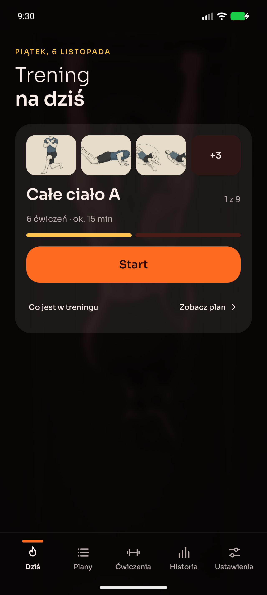

# mysttic-trainings

Aplikacja na Androida do treningów w domu. Podajesz wzrost, wagę, cel, poziom, sprzęt i to, ile minut
masz na trening — dostajesz gotowy cykl i jeden ekran z jednym przyciskiem. Aplikacja prowadzi przez
serie i przerwy, liczy powtórzenia i czas, zapisuje historię i sama proponuje, kiedy podnieść cele.

Bez reklam, bez subskrypcji, bez konta. Dane leżą na telefonie i nigdzie nie wyjeżdżają; jedyne
zapytanie do sieci to sprawdzenie, czy wyszła nowsza wersja, i dzieje się wyłącznie na twoje życzenie.



## Co robi

- **Układa plan.** Kreator zbiera dane, generator buduje cykl (domyślnie 30 dni) i trafia w zadeklarowany
  czas sesji z dokładnością do minuty. Ten sam profil zawsze daje ten sam plan — bez losowania.
- **Pokazuje jeden trening.** „Dziś” to miniatury ćwiczeń, nazwa treningu, liczba ćwiczeń, czas i Start. Bez listy
  do wybierania; wszystkie plany są obok, w zakładce Plany.
- **Prowadzi przez trening.** Odliczanie, serie na powtórzenia i na czas, przerwy z dokładaniem sekund,
  beep na 3-2-1, wibracja i głos zapowiadający kolejne ćwiczenie. Trening idzie dalej przy zgaszonym
  ekranie, a powiadomienie ma chronometr i sterowanie.
- **Rozlicza plan kolejką, nie kalendarzem.** Pominięty dzień nic nie kasuje — trening czeka. Seria dni
  z rzędu przeżywa zaplanowany odpoczynek.
- **Dopasowuje się do sprzętu.** Ćwiczenie wymaga całego swojego zestawu; przy braku sprzętu aplikacja
  proponuje zamiennik na tę samą partię.
- **Zmienia poziom w każdej chwili**, także w środku serii: wykonane kroki zostają, reszta się przelicza.
- **Zapamiętuje.** Historia z filtrami, statystyki okresu, wykresy wolumenu i rekordów, kalendarz aktywności,
  kopia zapasowa w jednym pliku JSON.
- **Podpowiada progresję.** Komplet serii na cel to propozycja „+1 powtórzenie” albo „+5 sekund”,
  a po dobiciu limitu — trudniejszy wariant ćwiczenia.
- **Przypomina** o treningu o wybranej godzinie i tylko wtedy, gdy tego dnia jeszcze nie trenowałeś.
- **Aktualizuje się sama**: pyta stronę projektu o nowsze wydanie, pobiera APK i oddaje go systemowemu instalatorowi.

## Skąd wziąć

Ze strony projektu: <https://mysttic.github.io/Mysttic/mysttic-trainings/>. Przycisk pobiera
`mysttic-trainings-<wersja>-android.apk` z publicznych wydań `Mysttic/Mysttic`. Instalujesz raz,
ręcznie (Android zapyta o zgodę na instalację spoza sklepu); kolejne wersje aplikacja pobierze sama,
gdy włączysz to w Ustawieniach.

Pliki wydań leżą na stronie projektu: jedzie tam sam APK i dwie linijki opisu (D-33), a baza ćwiczeń
ma tam własne wydania (D-47).

Wymagania: Android 8.0 (API 26) lub nowszy.

## Jak to działa, w pięciu linijkach

1. Kreator zapisuje profil, `PlanGenerator` buduje z niego treningi i rozkłada je na dni cyklu.
2. `WorkoutPlanner` rozwija szablon treningu w listę kroków dla twojego poziomu trudności.
3. `WorkoutEngine` to czysta funkcja `(stan, zdarzenie) -> (stan, efekty)`; zdarzenia niosą własny czas.
4. `PlayerController` w foreground service wykonuje efekty: dźwięk, głos, zapis serii, checkpoint.
5. Room trzyma historię, DataStore ustawienia, a wszystko poza `domain/` da się wymienić bez ruszania reguł.

## Dokumentacja

| Dokument | O czym |
|---|---|
| [docs/guide.md](docs/guide.md) | Przewodnik użytkownika: od pierwszego uruchomienia po aktualizacje |
| [docs/poradnik-trenera.md](docs/poradnik-trenera.md) | Poradnik dla trenera: pierwszy plan dla klienta krok po kroku, od pustego planu do wysłanego pliku |
| [docs/ARCHITECTURE.md](docs/ARCHITECTURE.md) | Silnik, model danych, warstwy, dopasowanie sprzętu |
| [docs/building.md](docs/building.md) | Build, podpis, keystore, wymagania środowiska |
| [docs/testing.md](docs/testing.md) | Co jest testowane i jak to uruchomić |
| [docs/CONTRIBUTING.md](docs/CONTRIBUTING.md) | Gałęzie, wydania, styl commitów |
| [docs/privacy-policy.md](docs/privacy-policy.md) | Jakie dane, gdzie leżą, co wychodzi do sieci |
| [docs/SECURITY.md](docs/SECURITY.md) | Zgłaszanie problemów bezpieczeństwa |
| [docs/THIRD-PARTY-NOTICES.md](docs/THIRD-PARTY-NOTICES.md) | Biblioteki, zdjęcia, licencje |
| [docs/SEED.md](docs/SEED.md) | Jak zmieniać bazę ćwiczeń |
| [docs/DECISIONS.md](docs/DECISIONS.md) | Decyzje projektowe (ADR) |
| [docs/PLAN.md](docs/PLAN.md) | Kamienie milowe i status |
| [docs/site-page.md](docs/site-page.md) | Strona projektu na mysttic.github.io: umowa o wydaniach i teksty |
| [CHANGELOG.md](CHANGELOG.md) | Co się zmieniło w kolejnych wydaniach |

## Praca nad kodem

```
gradlew.bat assembleDebug          # debug APK
gradlew.bat testDebugUnitTest      # testy jednostkowe warstwy domain
gradlew.bat installDebug           # instalacja na podłączonym telefonie
```

Pracujemy na `develop`, wydajemy przez PR do `master` z podniesionym [VERSION.md](VERSION.md) — szczegóły
w [docs/CONTRIBUTING.md](docs/CONTRIBUTING.md). Zasady, których trzyma się kod (i Claude Code), są
w [CLAUDE.md](CLAUDE.md).

Stack: Kotlin, Jetpack Compose (Material 3), Hilt, Room, DataStore, Navigation Compose, Health Connect;
AGP 9, Gradle 9.5, minSdk 26.

## Licencja

Kod jest na licencji [MIT](LICENSE). Baza ćwiczeń w `baza/` (nazwy, opisy, instrukcje i ilustracje) jest
na licencji [CC BY 4.0](https://creativecommons.org/licenses/by/4.0/deed.pl), autor: Mysttic. Materiały
zewnętrzne (część danych o ćwiczeniach, krój pisma, biblioteki) mają własne licencje, wypisane
w [docs/THIRD-PARTY-NOTICES.md](docs/THIRD-PARTY-NOTICES.md).
