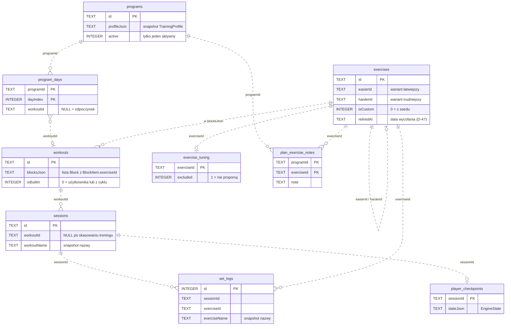

# Schemat bazy danych

Room, plik `trainings.db`, **wersja 6** (`AppDatabase.version`). Wyeksportowany schemat leży w
`app/schemas/pl.mysttic.trainings.data.db.AppDatabase/<wersja>.json` i to on jest źródłem prawdy — ten dokument
opisuje ten sam schemat po ludzku. Spójność pilnuje `python tools/check_schema.py`.

Trzy rzeczy, które trzeba wiedzieć, zanim się to czyta:

1. **Nie ma kluczy obcych.** Żadna tabela nie deklaruje `ForeignKey` — powiązania są po konwencji (`workoutId`,
   `exerciseId`, `sessionId`, `programId`). Tak jest celowo: historia ma przeżyć skasowanie treningu, a seed
   nadpisuje ćwiczenia przy każdej nowej wersji. Konsekwencja: kasowanie kaskadowe robimy ręcznie
   (`SessionRepository.deleteSession` kasuje serie i checkpoint, `ProgramRepository.delete` kasuje dni cyklu).
2. **Część danych siedzi w JSON-ie w kolumnie tekstowej** — bloki treningu, profil kreatora, stan playera
   (patrz [JSON w kolumnach](#json-w-kolumnach)). To decyzja D-04: bloki zmieniają kształt częściej niż schemat bazy.
3. **Ustawienia to nie baza.** Poziom, sprzęt, sygnały i wersja seedu leżą w DataStore (`settings.preferences_pb`).

## Skąd się biorą dane

| tabela | kto wypełnia | kiedy |
|---|---|---|
| `exercises` | `SeedImporter` z assetu `exercises.json` (katalog `baza/`, D-47); `ExerciseRepository.save` dla własnych | przy starcie aplikacji, gdy `version` bazy > zapisanej w DataStore |
| `workouts` | `SeedImporter` (wbudowane do v6, od v7 tylko sprząta), `WorkoutRepository` (edytor), `ProgramRepository` (kreator, gotowe programy, kopie i treningi planu, D-42), `PlanShareRepository` (import pliku planu) | seed przy starcie, reszta na żądanie |
| `programs`, `program_days` | `ProgramRepository.save` po kreatorze planu | przy zakładaniu cyklu |
| `sessions`, `set_logs` | `SessionRepository` wołane z `PlayerController` | w trakcie treningu |
| `player_checkpoints` | `SessionRepository.saveCheckpoint` z `PlayerController` / `WorkoutService` | co tick treningu |
| `exercise_tuning` | `CoachRepository` z podsumowania treningu (D-35) | po opinii o ćwiczeniu |
| `plan_exercise_notes` | `ProgramRepository.setNote` ze szczegółów treningu; kopia planu, import pliku planu i kopii (D-44) | na żądanie |

## Mapa



Linie przerywane, bo to powiązania po konwencji — baza ich nie pilnuje.

## Tabele

### `exercises` — biblioteka ćwiczeń

Klucz główny: `id` (kebab-case, stabilny; trafia do historii, więc nie wolno go zmieniać po wydaniu).
Indeksów brak: 283 wiersze (baza v10) czyta się w całości.

| kolumna | typ | null | opis |
|---|---|---|---|
| `id` | TEXT | nie | `pushups`, `goblet-squat` |
| `nameEn` | TEXT | nie | nazwa oryginalna z datasetu |
| `namePl` | TEXT | nie | nazwa pokazywana w aplikacji |
| `kind` | TEXT | nie | `ExerciseKind`: `REPS` \| `TIME` — decyduje, czy cel to powtórzenia czy sekundy (D-27) |
| `level` | TEXT | nie | `Difficulty`: `BEGINNER` \| `INTERMEDIATE` \| `ADVANCED` |
| `category` | TEXT | nie | `ExerciseCategory`: `STRENGTH` \| `CARDIO` \| `PLYOMETRICS` \| `STRETCHING` \| `BREATHING` |
| `equipment` | TEXT | nie | JSON, lista nazw `Equipment` — zbiór **wymagany w całości**; `[]` = bez sprzętu |
| `primaryMuscles` | TEXT | nie | JSON, lista `MuscleGroup` — po tym dobiera generator planu |
| `secondaryMuscles` | TEXT | nie | JSON, lista `MuscleGroup` |
| `instructionsPl` | TEXT | nie | JSON, lista kroków (seed daje zawsze 3) |
| `images` | TEXT | nie | JSON, lista ścieżek względem korzenia assetów (katalog `baza/`, D-47), np. `images/pushups.jpg`; do bazy v9 `seed/images/pushups/0.jpg`. Jedno zdjęcie = ilustracja (D-36), dwa = pozycja startowa i końcowa. Pojedynczy kadr w UI bierzemy z **końca** listy (D-25) |
| `easierId` | TEXT | tak | ćwiczenie o poziom niżej — podmiana w `WorkoutPlanner` |
| `harderId` | TEXT | tak | ćwiczenie o poziom wyżej |
| `defaultReps` | INTEGER | nie | domyślny cel dla `kind = REPS` |
| `defaultSeconds` | INTEGER | nie | domyślny cel dla `kind = TIME` |
| `isCustom` | INTEGER | nie | `1` = dodane przez użytkownika, seed go nie tyka i wchodzi do kopii zapasowej |
| `retiredAt` | TEXT | tak | data wycofania z bazy (D-47), `RRRR-MM-DD`; null = w użyciu. Wycofane zostaje dla historii, planów, notatek i trenera, ale nie ma go w bibliotece, kreatorze, zamiennikach ani wyszukiwarce edytora. Przychodzi z bazy przy imporcie |

### `workouts` — szablony treningów

Klucz główny: `id`. Bez indeksów.

| kolumna | typ | null | opis |
|---|---|---|---|
| `id` | TEXT | nie | trening planu: `plan-ab12cd34-1` (kreator), `plan-ab12cd34-s2` (etap gotowego programu), `plan-ab12cd34-w1a2b3c4d` (dopisany albo skopiowany w edytorze planu, D-42); UUID = dawna kopia z „Duplikuj do edycji” (D-19); `full-body-a` itp. tylko w bazach sprzed seedu v7, z historią |
| `name` | TEXT | nie | „Całe ciało A" |
| `note` | TEXT | nie | podpis pod nazwą; generator wpisuje tu cel, czas i poziom |
| `blocksJson` | TEXT | nie | JSON `List<Block>` — patrz niżej |
| `createdAt` | INTEGER | nie | epoch ms |
| `updatedAt` | INTEGER | nie | epoch ms |
| `isBuiltIn` | INTEGER | nie | `1` = z seedu. Od seedu v7 seed nie wozi treningów, a import kasuje wbudowane bez sesji (D-43); zostają tylko te z historią, dalej nie do edycji w miejscu (D-19, `WorkoutEditing.canEdit`) i poza kopią zapasową |

### `sessions` — wykonane treningi

Klucz główny: `id` (UUID). Indeksy: `startedAt`, `workoutId`, `programId`.

| kolumna | typ | null | opis |
|---|---|---|---|
| `id` | TEXT | nie | UUID sesji |
| `workoutId` | TEXT | tak | trening, z którego poszła sesja; po skasowaniu treningu zostaje stare id (nic go nie zeruje) |
| `workoutName` | TEXT | nie | snapshot nazwy — historia ma być czytelna po skasowaniu treningu |
| `difficulty` | TEXT | nie | poziom z końca sesji: zamknięcie, także przerwanie, zapisuje poziom ze stanu silnika, więc zmiana w trakcie trafia do wpisu (sesje zamknięte przed wersją z bazą v4 mają poziom ze startu). Trening stały (gotowy program, plan dosłowny) startuje z poziomem z profilu planu, do którego należy (D-43) |
| `startedAt` | INTEGER | nie | epoch ms |
| `endedAt` | INTEGER | tak | `NULL` dla sesji w toku |
| `status` | TEXT | nie | `SessionStatus`: `IN_PROGRESS` \| `DONE` \| `ABANDONED` |
| `rpe` | INTEGER | tak | ocena wysiłku od 6 do 10 (zapas powtórzeń, D-46) z podsumowania albo Historii; starsze wpisy z Historii mogą mieć od 1 do 5 |
| `note` | TEXT | nie | notatka użytkownika |
| `programId` | TEXT | tak | plan, z którego trening był uruchomiony (D-42) — snapshot z chwili startu; `NULL` = trening spoza planu. Migracja 3 → 4 wypełniła go dawną regułą kolejki |
| `plannedSets` | INTEGER | tak | liczba serii (kroków pracy) przewidzianych w chwili zakończenia, po zmianie poziomu w trakcie; `NULL` w sesjach sprzed v4 |

### `set_logs` — pojedyncze serie

Klucz główny: `id` (autoinkrement). Indeksy: `sessionId`, `exerciseId`.

| kolumna | typ | null | opis |
|---|---|---|---|
| `id` | INTEGER | nie | autoinkrement |
| `sessionId` | TEXT | nie | sesja, w której seria padła |
| `exerciseId` | TEXT | nie | ćwiczenie **pokazane na ekranie** (po podmianie wariantu poziomem), nie z szablonu |
| `exerciseName` | TEXT | nie | snapshot nazwy |
| `blockIndex`, `itemIndex` | INTEGER | nie | miejsce w szablonie treningu |
| `round` | INTEGER | nie | runda obwodu (CIRCUIT) |
| `setIndex` | INTEGER | nie | numer serii (SETS) |
| `targetKind` | TEXT | nie | `TargetKind`: `REPS` \| `SECONDS` \| `AMRAP` |
| `targetValue` | INTEGER | nie | cel po skalowaniu poziomem i korekcie trenera |
| `actualValue` | INTEGER | nie | ile faktycznie zrobiono |
| `weightKg` | REAL | tak | obciążenie, gdy podane |
| `completedAt` | INTEGER | nie | epoch ms |

To jest tabela, z której liczą się wszystkie statystyki (`domain/stats`) i propozycje progresji (`SetProgression`).

### `player_checkpoints` — stan treningu w toku

Klucz główny: `sessionId`. Jeden wiersz na sesję w toku; kasowany po zakończeniu.

| kolumna | typ | null | opis |
|---|---|---|---|
| `sessionId` | TEXT | nie | sesja, której dotyczy stan |
| `stateJson` | TEXT | nie | serializowany `EngineState` |
| `savedAtWall` | INTEGER | nie | `System.currentTimeMillis()` — przeżywa reboot |
| `savedAtElapsed` | INTEGER | nie | `SystemClock.elapsedRealtime()` — spójny z timestampami w stanie |

Dwa zegary, bo po reboocie `elapsedRealtime` zaczyna od zera: różnica zegarów ściennych mówi, ile naprawdę minęło.

### `programs` — plany (kreator, gotowe programy, własne, od kogoś)

Klucz główny: `id` (`plan-<8 znaków UUID>`, używany też jako prefiks id treningów cyklu).

| kolumna | typ | null | opis |
|---|---|---|---|
| `id` | TEXT | nie | id cyklu |
| `name` | TEXT | nie | „Plan na 30 dni · kondycja" |
| `profileJson` | TEXT | nie | snapshot `TrainingProfile` — od tych wartości startuje kolejny cykl |
| `startedAt` | INTEGER | nie | początek dnia 1 (zegar ścienny; numeracja dni kalendarzowa) |
| `cycleDays` | INTEGER | nie | długość cyklu w dniach |
| `createdAt` | INTEGER | nie | epoch ms |
| `active` | INTEGER | nie | `1` dla jednego planu naraz; pozostałe czekają na liście z własnym postępem (D-42) |
| `source` | TEXT | nie | `PlanSource`: `WIZARD` \| `PRESET` \| `CUSTOM` \| `IMPORTED` (D-42); migracja 3 → 4 rozpoznała presety po `presetId` w profilu |
| `description` | TEXT | nie | opis planu od autora, pusty dla planów z kreatora |
| `author` | TEXT | nie | kto ułożył plan; pusty = sam użytkownik |
| `originId` | TEXT | tak | plan, z którego ten powstał (duplikat, powtórka) |
| `shareUid` | TEXT | tak | tożsamość planu między telefonami, nadawana przy pierwszym eksporcie do pliku |
| `updatedAt` | INTEGER | nie | epoch ms ostatniej zmiany (aktywacja, nazwa) |
| `rhythmStart` | INTEGER | nie | kotwica rytmu dni po wznowieniu wstrzymanego planu; `0` = od `startedAt` |

### `program_days` — rozkład dni cyklu

Klucz główny złożony: (`programId`, `dayIndex`). Indeksy: `programId`, `workoutId`.

| kolumna | typ | null | opis |
|---|---|---|---|
| `programId` | TEXT | nie | cykl |
| `dayIndex` | INTEGER | nie | numer dnia, liczony od 1 |
| `workoutId` | TEXT | tak | `NULL` = dzień odpoczynku |

Plan rozliczamy kolejką, nie datami (D-21): dzień jest odhaczony przez ukończoną sesję tego treningu, niezależnie kiedy.
Od v4 sesja należy do planu przez `sessions.programId`; sesje bez niego rozlicza dawna reguła (`PlanSessions`).
Treningi planu mają id z prefiksem `"<programId>-"`, więc trening należy do jednego planu (D-42).
Rozkład dni zostaje tylko rytmem tygodnia (i zasilaniem serii dni na „Dziś").

### `exercise_tuning` — pamięć trenera (D-35)

Klucz główny: `exerciseId`.

| kolumna | typ | null | opis |
|---|---|---|---|
| `exerciseId` | TEXT | nie | ćwiczenie, którego dotyczy opinia |
| `repsDelta` | INTEGER | nie | korekta celu w powtórzeniach, wchodzi **po** skalowaniu poziomem |
| `secondsDelta` | INTEGER | nie | korekta celu w sekundach |
| `excluded` | INTEGER | nie | `1` = „nie chcę": podmiana w aktywnym cyklu i pominięcie w kolejnych planach |
| `updatedAt` | INTEGER | nie | epoch ms |

### `plan_exercise_notes`: notatki do ćwiczeń w planie (D-44)

Klucz główny: `programId` + `exerciseId`. Indeks: `programId`.
Notatka (np. ciężar) wraca przy tym ćwiczeniu w każdym treningu i tygodniu jednego planu; w innym planie jej nie ma.

| kolumna | typ | null | opis |
|---|---|---|---|
| `programId` | TEXT | nie | plan, do którego należy notatka (`programs.id`) |
| `exerciseId` | TEXT | nie | ćwiczenie pokazane na ekranie (po wariancie poziomu), jak klucz trenera |
| `note` | TEXT | nie | tekst do 280 znaków, oczyszczony jak wskazówka w edytorze; pusty wiersz nie istnieje |
| `updatedAt` | INTEGER | nie | epoch ms |

## Powiązania (bez kluczy obcych)

| z | do | kolumna | co się dzieje, gdy cel zniknie |
|---|---|---|---|
| `program_days` | `workouts` | `workoutId` | dzień planu pokaże pustkę; `ProgramRepository.delete` kasuje w transakcji treningi planu (z dni i z prefiksem id), których nie ma żadna sesja; resztki po wersjach sprzed 0.9.1 sprząta `SeedImporter` przy podbiciu seedu (`deleteOwnerlessPlanWorkouts`, D-43) |
| `sessions` | `workouts` | `workoutId` | historia zostaje, nazwa z `workoutName`; progresja celów przestaje działać dla tej sesji |
| `set_logs` | `sessions` | `sessionId` | `deleteSession` kasuje serie ręcznie; osierocone serie to błąd |
| `set_logs` | `exercises` | `exerciseId` | wpis historii zostaje, nazwa z `exerciseName` |
| `sessions` | `programs` | `programId` | sesja zostaje w Historii; statystyk usuniętego planu już nie ma |
| `workouts.blocksJson` | `exercises` | `BlockItem.exerciseId` | `WorkoutPlanner` pokazuje pozycję z id zamiast nazwy |
| `exercises` | `exercises` | `easierId`, `harderId` | `tools/baza.py sprawdz` i `SeedIntegrityTest` pilnują spójności w bazie |
| `exercise_tuning` | `exercises` | `exerciseId` | wiersz zostaje bez efektu |
| `plan_exercise_notes` | `programs` | `programId` | `ProgramRepository.delete` kasuje notatki razem z planem |
| `plan_exercise_notes` | `exercises` | `exerciseId` | notatka zostaje bez efektu (ćwiczenie nie pojawi się w planie) |

## JSON w kolumnach

### `workouts.blocksJson` — `List<Block>` (D-04)

```
Block(kind: SETS|CIRCUIT, rounds: Int, restBetweenRoundsSec: Int, items: List<BlockItem>, fixed: Boolean = false, restAfterSec: Int? = null, label: String = "")
BlockItem(exerciseId, targetKind, targetValue, sets, restAfterSetSec, restAfterItemSec, weightKg?, openEnded: Boolean = false, cadenceSec: Int? = null, note: String = "", windowSec: Int? = null)
```

`SETS` to serie proste jednego ćwiczenia, `CIRCUIT` to rundy przez listę (tabata = CIRCUIT z celami czasowymi).
`targetValue` jest wartością bazową dla poziomu `INTERMEDIATE` — skalowanie robi `WorkoutPlanner`, nigdy UI.
`fixed` (D-37) znaczy stały protokół gotowego programu: planner nie skaluje celów ani przerw, nie podmienia wariantu i nie
nakłada korekty trenera; `restAfterSec` nadpisuje domyślną minutę przerwy po bloku (0 = bez przerwy); `openEnded` to krok
na czas bez limitu (czas w górę, koniec przez „Zrobione”), `cadenceSec` to sygnał rytmu co tyle sekund.
`label` to nazwa bloku od autora planu, `note` to wskazówka do pozycji, którą pokazuje player (D-42).
`windowSec` (D-43) to okno EMOM: praca i przerwa po niej mają razem trwać tyle sekund, a długość przerwy liczy silnik
z faktycznego czasu pracy, nie planner.
**Nowe pole musi mieć wartość domyślną**, inaczej stare wiersze przestaną się parsować.

### `programs.profileJson` — `TrainingProfile`

Wzrost, waga, cel, poziom, dni w tygodniu, minuty sesji, długość cyklu, sprzęt, `targetScale` (mnożnik z progresji, D-22),
`presetId` i `presetParam` (D-37: gotowy program, z którego powstał cykl, i jego parametr; null = kreator).
Snapshot z chwili generowania — kolejny cykl startuje z tych wartości (kreator bierze ostatni cykl z kreatora, nie preset).

### `player_checkpoints.stateJson` — `EngineState`

Stan maszyny silnika. Dodanie pola z wartością domyślną jest bezpieczne; **usunięcie pola wymaga wyczyszczenia
tabeli w migracji**, bo stary JSON przestanie się parsować. Od D-37 stan ma `lastCueIndex` (ostatni sygnał rytmu)
i `pendingCount` (licznik „ile dasz radę” z ekranu), oba z wartościami domyślnymi.
Kroki w `steps` też są tu zapisane: od D-43 `Step.Rest` niesie `windowSec` (okno EMOM), a `seconds` jest wtedy wartością
policzoną przy wejściu w przerwę, nie estymatą plannera. `Step.Work` niesie `windowSec` tej samej pozycji, a od D-42
także `note` i `blockLabel`.

## Enumy

Room zapisuje enumy po nazwie (`"BEGINNER"`), listy i zbiory idą przez `Converters` jako JSON z nazwami.
**Dopisanie wartości jest bezpieczne, zmiana i usunięcie nazwy psuje istniejące wiersze.**

| enum | wartości | gdzie |
|---|---|---|
| `ExerciseKind` | `REPS`, `TIME` | `exercises.kind` |
| `Difficulty` | `BEGINNER`, `INTERMEDIATE`, `ADVANCED` | `exercises.level`, `sessions.difficulty`, DataStore |
| `ExerciseCategory` | `STRENGTH`, `CARDIO`, `PLYOMETRICS`, `STRETCHING`, `BREATHING` | `exercises.category` |
| `Equipment` | `DUMBBELLS`, `KETTLEBELL`, `RESISTANCE_BAND`, `PULL_UP_BAR`, `LOW_BAR`, `BENCH`, `JUMP_ROPE`, `MEDICINE_BALL`, `EXERCISE_BALL`, `BARBELL`, ergometry (D-44): `ROWING_MACHINE`, `STATIONARY_BIKE`, `ELLIPTICAL`, `TREADMILL` | `exercises.equipment`, DataStore |
| `MuscleGroup` | 18 partii od `CHEST` do `FULL_BODY` | `exercises.primaryMuscles`, `secondaryMuscles` |
| `TargetKind` | `REPS`, `SECONDS`, `AMRAP` | `set_logs.targetKind`, `blocksJson` |
| `BlockKind` | `SETS`, `CIRCUIT` | `blocksJson` |
| `SessionStatus` | `IN_PROGRESS`, `DONE`, `ABANDONED` | `sessions.status` |
| `Goal` | `STRENGTH`, `CONDITION`, `FAT_LOSS`, `MOBILITY` | `profileJson` |

## Ustawienia (DataStore, nie baza)

Plik `settings.preferences_pb`, klucze z `SettingsRepository.Keys`:

| klucz | typ | domyślnie | znaczenie |
|---|---|---|---|
| `difficulty_level` | Int | 2 | poziom trudności (1–3), globalny |
| `owned_equipment` | Set<String> | pusty | posiadany sprzęt — twardy filtr w generatorze |
| `countdown_sec` | Int | 5 | odliczanie przed serią |
| `sound_enabled`, `tts_enabled`, `vibration_enabled` | Bool | true | sygnały playera |
| `keep_screen_on` | Bool | true | ekran w trakcie treningu |
| `seed_version` | Int | 0 | wersja zaimportowanego seedu — po jej podbiciu leci re-import |
| `reminder_enabled`, `reminder_hour`, `reminder_minute` | Bool/Int | false, 18:00 | codzienne przypomnienie (D-29) |
| `volume_key_done` | Bool | true | przycisk głośności jako „Zrobione" (D-30) |
| `health_connect_enabled` | Bool | false | zapis sesji do Health Connect (D-31) |
| `update_checks`, `last_update_check` | Bool/Long | false, 0 | sprawdzanie aktualizacji (D-33) |
| `author_name` | String | pusty | imię na planach wysyłanych innym i na raportach (D-42) |
| `theme_id` | String | `fire` | wybrany motyw (D-39) |
| `backgrounds` | Set<String> | pusty | tło każdego motywu jako wpisy `motyw=tło`, np. `fire=zar`; brak wpisu = tło jednolite (D-50) |
| `photo_people` | String | `oboje` | kogo pokazywać na zdjęciu dnia: `kobieta`, `mezczyzna` albo `oboje` (D-51) |

## Kopia zapasowa (D-18)

`BackupRepository` eksportuje JSON przez SAF (plik w wersji 5). **Co wchodzi:** ćwiczenia własne (`isCustom = 1`),
treningi użytkownika (`isBuiltIn = 0`), wszystkie sesje i serie (z `programId`), pamięć trenera, plany z dniami (od v2),
notatki do ćwiczeń w planach (od v4, D-44) i komplet ustawień, z tłem każdego motywu (od v5, D-50; kopia sprzed v5
nie zmienia wybranych teł ani wyboru osób na zdjęciu dnia, D-51). **Czego nie ma:** ćwiczeń wbudowanych (odtwarza je seed), wbudowanych treningów (od seedu v7 seed ich
nie wozi), checkpointów i zdjęć.
Import jest addytywny i idzie w jednej transakcji: sesje i plany o znanych `id` pomija razem z ich treningami
i notatkami, ćwiczenie o id wbudowanego pomija. Plan z pliku v1/v2 dostaje źródło z `profileJson` tą samą regułą co migracja 3 → 4. Plik planu (D-42) ma
własny format i import kopii go odrzuca.

## Migracje

Zasada (D-05): zmiana encji = `version + 1` w `AppDatabase` + `Migration` w `MIGRATIONS` + aktualizacja tego pliku.
Bez `fallbackToDestructiveMigration` — historia treningów to dane użytkownika.

| wersja | co doszło |
|---|---|
| 1 | `exercises`, `workouts`, `sessions`, `set_logs`, `player_checkpoints` |
| 2 | `programs`, `program_days` — cykle z kreatora (D-20) |
| 3 | `exercise_tuning` — pamięć trenera (D-35) |
| 4 | `programs.source/description/author/originId/shareUid/updatedAt/rhythmStart`, `sessions.programId/plannedSets` — lista planów i plan w sesji (D-42) |
| 5 | `plan_exercise_notes`: notatki do ćwiczeń w obrębie planu (D-44) |
| 6 | `exercises.retiredAt`: data wycofania ćwiczenia z bazy (D-47); kolumna bez wartości, więc wszystko zostaje w użyciu |

## Co dojdzie (szkic, jeszcze nie ma w kodzie)

Plany trenerskie wybierane na cały cykl wymagają dwóch rzeczy w schemacie:

- `exercises.pattern` — wzorzec ruchu (`MovementPattern`: wyciskanie poziomo/pionowo, przyciąganie poziomo/pionowo,
  push obunóż/jednonóż, hinge, core, akcesorium). Z mięśni się tego nie wyliczy, a bez tego nie da się obsadzić
  slotu z planu trenera. Kolumna z wartością domyślną + wyższy numer bazy ćwiczeń (D-47).
- `plan_templates` — gotowe plany jako dane: nazwa, autor, poziom, dni w tygodniu, dni planu ze slotami
  (wzorzec albo konkretne ćwiczenie, serie, zakres powtórzeń). Generator obsadza sloty z biblioteki i wypuszcza
  zwykły cykl, więc `programs`, `program_days` i reszta zostają bez zmian.

Do tego biblioteka nie ma dziś ani jednego ćwiczenia ze sztangą (`BARBELL` istnieje w enumie, ćwiczeń brak) —
plany siłowe wymagają dosiania seedu.
